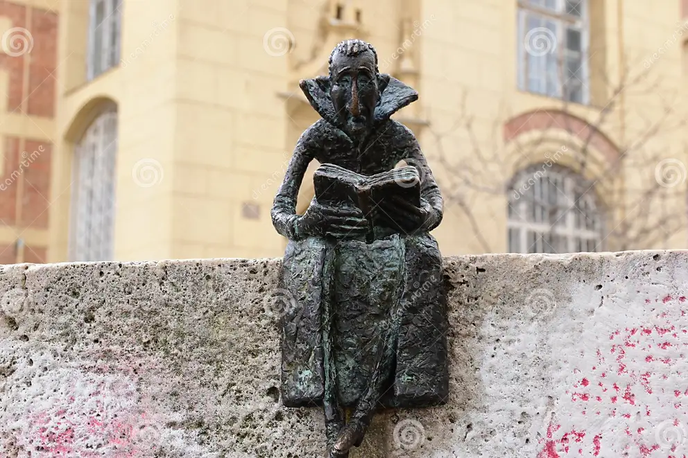

# Szobrok

### Drakula

*Kolodko Mihály kárpátaljai származású szobrászművész apró bronzszobrai Budapest különleges látványosságai közé tartoznak. Alkotásai gyakran híres személyeket, mesefigurákat vagy kulturális jelképeket ábrázolnak, és sokszor humoros, elgondolkodtató üzenetet hordoznak. Ezek közé tartozott a Drakula-miniszobor is, amely a Városligetben, a Vajdahunyad vára közelében kapott helyet.*

*A kis szobor egy köpenyes vámpírt ábrázolt, aki nyugodtan olvasott egy könyvet. Az alkotás különlegessége abban rejlett, hogy a félelmetesnek ismert Drakula alakját hétköznapi, szinte kedves helyzetben mutatta be. A figura egyszerre utalt a világhírű vámpírlegendára és Lugosi Bélára, a magyar származású színészre, aki a filmvásznon tette igazán ismertté Drakulát. A karakter történelmi előképe, Vlad Țepeș, szintén kapcsolatot teremtett a mű és a valós történelem között.*

*A szobor jelentősége abban állt, hogy a művészetet közelebb hozta az emberekhez. Kis mérete miatt könnyű volt elsétálni mellette, ezért a megtalálása igazi felfedezéssé vált. Kolodko alkotásai arra ösztönzik a járókelőket, hogy figyelmesebben szemléljék környezetüket, és a városi sétát kulturális kalandként éljék meg.*

*A Drakula-szobor 2026 júliusában eltűnt a helyéről, ami felhívta a figyelmet a köztéri műalkotások sérülékenységére is. Bár már nem látható eredeti helyén, emléke tovább él azokban, akik felfedezték. Története jól példázza, hogy egy apró szobor is jelentős kulturális értéket képviselhet, és maradandó élményt nyújthat a város lakóinak és látogatóinak.*

### Micimackó

*Kolodko Mihály kárpátaljai származású szobrászművész apró bronzszobrai Budapest különleges látványosságai közé tartoznak. Alkotásai gyakran híres mesefigurákat, történelmi személyeket vagy kulturális jelképeket ábrázolnak. A Micimackót megörökítő miniszobra is ilyen mű, amely egy kedves mesehőst kapcsol össze a magyar irodalom történetével.*

*A szobor Budapest VII. kerületében, a Damjanich utca 27. szám alatt található, azon az épületen, ahol Karinthy Frigyes író 1887. június 24-én született. Az alkotást 2023. június 24-én, Karinthy születésének évfordulóján helyezték el. A kis bronzfigura a fejjel lefelé fordított mézescsuprot tartó Micimackót ábrázolja, aki még az utolsó csepp mézet is szeretné megszerezni.*

*A szobor története szorosan összefügg A. A. Milne angol író Micimackó című meseregényével. A mű magyar változata 1935-ben jelent meg Karinthy Frigyes fordításában. A fordítás előkészítésében Karinthy nővére, Emília is fontos szerepet játszott, akit a családban Micinek becéztek. A magyar Micimackó név a hagyomány szerint az ő becenevéből született. Így a szobor nemcsak egy népszerű mesehősnek, hanem a magyar irodalom egyik jelentős alakjának és a családi összetartozásnak is emléket állít.*

*A mű jelentősége abban rejlik, hogy játékos formában kapcsolja össze a mesék világát a magyar kultúrával. Apró mérete ellenére felkelti a járókelők figyelmét, mosolyt csal az arcukra, és arra ösztönzi őket, hogy jobban megismerjék a helyszín történetét. A Micimackó-szobor bizonyítja, hogy egy egyszerű, kedves alkotás is őrizhet fontos irodalmi emlékeket, miközben színesebbé teszi a városi környezetet.*

### Garfield

*Kolodko Mihály kárpátaljai származású szobrászművész apró, különleges alkotásai Budapest számos pontján megtalálhatók. Szobrai gyakran ismert mesefigurákat és kulturális jelképeket ábrázolnak, sokszor humoros formában. Ezek közé tartozik a Garfieldot megörökítő alkotás is, amely egy világhírű képregényhősnek állít emléket.*

*A szobor Budapest VII. kerületében, a Dembinszky utcában, az Állatorvostudományi Egyetem kerítésén található. Kolodko Mihály 2023. június 19-én helyezte el, Garfield első képregénybeli megjelenésének 45. évfordulóján. A narancssárga macska figurája színes megjelenésével eltér a művész sok más, bronzból készült miniatűr alkotásától. A szobor különlegessége az elhelyezésében is rejlik: a kerítésen látható állatportrék, köztük egy kutyafej közelében kapott helyet, ami játékos ellentétet teremt a macska és a kutyák között.*

*Garfieldot Jim Davis amerikai képregényrajzoló alkotta meg. A figura 1978. június 19-én jelent meg először az újságokban, és hamar világszerte népszerűvé vált. A lusta, szarkasztikus, lasagnét kedvelő macska humorával és jellegzetes személyiségével több generáció kedvencévé vált. Kolodko alkotása ezt a jól ismert karaktert hozza közelebb a budapesti járókelőkhöz.*

*A szobor jelentősége abban rejlik, hogy összekapcsolja a nemzetközi popkultúrát a városi művészettel. Megmutatja, hogy egy köztéri alkotásnak nem feltétlenül kell monumentálisnak vagy komoly hangvételűnek lennie ahhoz, hogy értéket képviseljen. Garfield figurája mosolyt csal az emberek arcára, és a szobor felkutatása izgalmas élményt jelenthet a városban sétálóknak. Az alkotás így egyszerre tiszteleg egy népszerű képregényhős előtt, és teszi játékosabbá Budapest utcáit.*

### Roth Miksa

*Kolodko Mihály miniszobrai Budapest különleges látványosságai közé tartoznak. Az apró alkotások gyakran híres embereknek, történelmi eseményeknek vagy kulturális értékeknek állítanak emléket. Ezek közé tartozik Róth Miksa miniszobra is, amely a VII. kerületben, a Róth Miksa Emlékházban található. A mű különlegessége, hogy nem közterületen, hanem a művész egykori otthonában kapott helyet.*

*Róth Miksa a magyar üvegfestészet és mozaikművészet egyik legjelentősebb alakja volt. 1865-ben született Budapesten, és munkásságával nagyban hozzájárult a magyar szecessziós művészet fejlődéséhez. Alkotásai számos jelentős épületet díszítenek, üvegablakai pedig különleges színeikkel és részletgazdagságukkal váltak ismertté.*

*Művészetében fontos szerepet játszott a fény, amely életre keltette az üvegfelületeket.
Kolodko Mihály szobra Róth Miksát munka közben ábrázolja: egy üres ablakkeretet tart a kezében, miközben azon gondolkodik, milyen mintával díszítse azt. A kis figura egy lámpába épült, így a fény nemcsak a szobor megvilágítását szolgálja, hanem jelképes jelentést is kap. Utal Róth Miksa művészetének lényegére, hiszen az üvegablakok szépsége a fény hatására bontakozik ki.*

*A miniszobor jelentősége abban rejlik, hogy játékos, mégis elgondolkodtató módon őrzi egy kiemelkedő magyar művész emlékét. Arra ösztönzi a látogatókat, hogy jobban megismerjék Róth Miksa életét és munkásságát. Kolodko alkotása bizonyítja, hogy egy apró szobor is képes nagy értékeket közvetíteni, és közelebb hozni a múlt művészeti örökségét a mai emberekhez.*

### Búvár és kulcs

*Kolodko Mihály Búvár és kulcs című miniszobra Budapest egyik érdekes köztéri alkotása, amely egy régi városi legendát idéz fel. A szobor egy búvárt ábrázol, aki egy kulcsot keres vagy tart a kezében. Az alkotás a New York Kávéház történetéhez kapcsolódik, amely Budapest egyik leghíresebb és legszebb kávéháza. A legenda szerint a kávéház megnyitásakor Molnár Ferenc író és társai azt szerették volna, hogy a hely mindig nyitva maradjon a vendégek előtt. A történet egyik változata szerint ezért a kávéház kulcsát a Dunába dobták, hogy ne lehessen bezárni az épületet.*

*Kolodko Mihály szobra ezt a történetet eleveníti fel humoros formában. A búvár alakja arra utal, mintha valaki a folyó mélyére merült volna, hogy megtalálja az elveszett kulcsot. Bár a legenda részletei nem tekinthetők minden szempontból bizonyított történelmi ténynek, mégis a budapesti kávéházi kultúra egyik népszerű történetévé vált.*

*Az alkotás jelentősége abban rejlik, hogy egy apró szobor segítségével őriz meg egy érdekes városi legendát. A művész a humort és a történelmi emlékezetet kapcsolja össze, így a járókelők nemcsak egy szobrot látnak, hanem egy történetet is felfedezhetnek mögötte. A Búvár és kulcs jól példázza, hogyan válhat a köztéri művészet a városi múlt játékos közvetítőjévé.*
### Skála kópé

*Kolodko Mihály Skála Kópé című miniszobra a magyar reklámtörténet egyik ismert alakjának állít emléket. Skála Kópé az 1980-as években vált népszerűvé, amikor a Skála áruházak reklámjaiban szerepelt. A piros hajú, mosolygós figura és a hozzá kapcsolódó reklámdalok sok ember emlékezetében megmaradtak. A karakter a korszak kereskedelmi kultúrájának jellegzetes szereplőjévé vált, ezért a szobor különösen azok számára lehet érdekes, akik személyesen is emlékeznek erre az időszakra.*

*A miniszobor Budapesten, a Nyugati tér környékén található, az egykori Skála Metró áruház közelében. A helyszín kiválasztása fontos szerepet játszik az alkotás jelentésében, hiszen közvetlenül kapcsolódik ahhoz a környezethez, ahol a reklámfigura ismertté vált. Kolodko Mihály ezzel a művével a város múltjának egy hétköznapinak tűnő, mégis sokak számára emlékezetes részletét idézi fel.*

*A szobor jelentősége elsősorban a nosztalgiában és a közös emlékek megőrzésében rejlik. Megmutatja, hogy nemcsak híres történelmi személyek vagy nagy események érdemesek arra, hogy köztéri alkotások örökítsék meg őket. Egy reklámfigura is a társadalom és a kultúra részévé válhat. A Skála Kópé egyszerre humoros és emlékeztető alkotás, amely összekapcsolja a múltat a jelennel, és újra felidézi a régi magyar reklámok hangulatát.*
### Halott mókus

*Kolodko Mihály Halott mókus című miniszobra Budapest egyik különleges és meghökkentő alkotása. A kis bronzfigura egy elpusztult mókust ábrázol, amely egy bűnügyi helyszínre emlékeztető környezetben fekszik. A szobor a Falk Miksa utcában, a híres Columbo-szobor közelében található. Elhelyezése nem véletlen, hiszen a környék és a nyomozó alakja együtt egy képzeletbeli bűnügyi történet hangulatát teremti meg.
Az alkotás különlegessége a fekete humorban és a szokatlan témaválasztásban rejlik. Míg sok köztéri szobor híres embereket vagy történelmi eseményeket örökít meg, Kolodko itt egy apró állat tragikusnak tűnő történetét jeleníti meg. A figura egyszerre nevetséges és elgondolkodtató, mert a látogatókban kérdéseket ébreszt arról, mi történhetett vele. A szobor egyes értelmezések szerint a művészet mulandóságára és az élet törékenységére is utalhat.
A Halott mókus jelentősége abban rejlik, hogy megmutatja, a művészet nem feltétlenül csak szép vagy ünnepélyes dolgokat ábrázolhat. Néha a humor, a meghökkentés és a rejtély segítségével válik emlékezetessé. Kolodko Mihály ezzel az alkotással arra ösztönzi az embereket, hogy figyelmesebben nézzék a környezetüket, és saját történeteket képzeljenek a szobor mögé.*
### Yoda

*Kolodko Mihály Yoda-szobra a világhírű Star Wars-filmek egyik legismertebb szereplőjét ábrázolja. Yoda egy bölcs Jedi-mester, aki különleges képességeivel, nyugalmával és tanításaival segíti a fiatal Jediket. A figura a filmekben a tudás, a türelem és a belső erő jelképe. Kolodko Mihály alkotásának érdekessége, hogy egy apró méretű szobor formájában hozza közelebb a népszerű filmes világot a hétköznapi emberekhez.
A szobor Budapesten, a Szent Gellért téri metróállomáson található, ahol a modern városi környezet különleges helyszínt biztosít számára. Elhelyezése azért is érdekes, mert az emberek a mindennapi utazásuk során is felfedezhetik. A kis figura könnyen mosolyt csal az arra járók arcára, különösen azokéra, akik ismerik a Star Wars történetét.
Yoda alakja nemcsak a filmrajongók számára jelent sokat, hanem általánosabb üzenetet is hordoz. Arra emlékeztet, hogy a bölcsesség és a kitartás fontos szerepet játszik az életben. Kolodko Mihály szobra jól példázza, hogyan lehet a popkultúrát és a köztéri művészetet összekapcsolni. Az alkotás egyszerre humoros, felismerhető és gondolatébresztő, miközben színesebbé teszi Budapest városi környezetét.*
